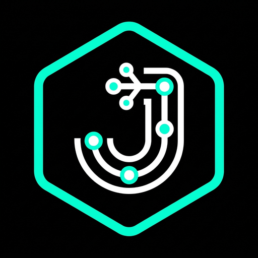

<p align="center">
  
</p>

# JAM (Just Another Mind)

JAM es un asistente de Inteligencia Artificial **local, privado y autónomo** diseñado para ejecutarse enteramente en tu propio hardware (Linux, macOS y Windows).

Con una interfaz TUI futurista y minimalista, JAM separa el **Chat limpio** del apartado de **Logs técnicos**, incorpora modelos locales **sin censura**, **memoria vectorial híbrida persistente (RAG)**, **reconocimiento facial 100% local** y conciencia de entorno (clima y geolocalización).

## Características Principales

- **Chat Limpio + Apartado de Logs (`Ctrl+L` / `/logs`):** La conversación muestra únicamente tus mensajes y las respuestas de JAM; toda la telemetría interna (`[SYS]`, `[HW]`, `[RAG]`, `[MNG]`, `[GEN]`, `[FACE]`) se envía a la pestaña separada **Logs** con marca de tiempo.
- **Privacidad Total:** Los datos, perfiles faciales y memoria RAG se guardan localmente en `jam_data/` (con telemetría de ChromaDB desactivada). Ningún dato privado viaja a la nube.
- **Modelos Locales Sin Censura (GGUF):** Recomendador automático de hardware que asigna modelos `Dolphin 3.0` (`0.5B`, `1.5B`, `3B`, `8B`) y `Qwen2.5-abliterated` (`14B`, `32B`) en formato GGUF `Q4_K_M` ejecutados con `llama.cpp`.
- **Memoria Vectorial Híbrida (RAG) con ChromaDB:**
  - Similitud coseno (`hnsw:space: cosine`) con filtrado de ruido por umbral de relevancia.
  - *Reranking* híbrido (Noisy-OR): similitud semántica + coincidencia léxica insensible a acentos (español/inglés) + importancia + recencia.
  - Deduplicación exacta y semántica (*upsert*) + *chunking* con solapamiento.
  - Memoria multicapa: perfil base, hechos relevantes, ventana reciente de chat e historial episódico recuperable.
- **Reconocimiento Facial Local (`/face`):** Motor 100% offline sobre OpenCV (`Haar Cascade` + descriptores espaciales `LBP + HOG` + `LBPH`) para registrar y autenticar tu rostro desde cámara web o imagen sin subir fotos a internet.
- **Empaquetado Windows `.exe` con Logo:** Workflow de GitHub Actions que compila automáticamente `JAM.exe` con icono personalizado (`assets/jam_logo.ico`) y genera `JAM-Windows-Portable.zip` listo para compartir.

---

## Instalación y Uso

### Linux y macOS

```bash
# 1. Clonar el repositorio
git clone https://github.com/diegoosanv/jam_assistant.git
cd jam_assistant

# 2. Crear entorno virtual (Python 3.11 o 3.12 recomendado) y activarlo
python3.11 -m venv .venv
source .venv/bin/activate

# 3. Instalar dependencias
pip install -r requirements.txt --extra-index-url https://abetlen.github.io/llama-cpp-python/whl/cpu

# 4. Iniciar JAM
python3 jam/main.py --lang es
```

### Windows (desde código fuente)

```cmd
git clone https://github.com/diegoosanv/jam_assistant.git
cd jam_assistant
python -m venv .venv
.venv\Scripts\activate
pip install -r requirements.txt --extra-index-url https://abetlen.github.io/llama-cpp-python/whl/cpu
python jam\main.py --lang es
```

### Windows (Ejecutable `.exe` listo para enviar)

Al hacer `git push` a `main`, GitHub Actions (`.github/workflows/build-windows.yml`) ejecuta las pruebas y compila automáticamente:
- `JAM.exe` (con el logo de JAM embebido)
- `JAM-Windows-Portable.zip` (incluye `JAM.exe` + `LEEME.txt`)

Puedes descargarlos desde **Actions -> Build Windows EXE -> Artifacts** y enviar el `.zip` o `JAM.exe` directamente a cualquier PC con Windows junto con una licencia válida.

---

## Comandos y Atajos dentro de JAM

- `Ctrl+L` o `/logs`: Alterna entre la pestaña **Chat** y la pestaña **Logs** técnicos.
- `/help`: Lista todos los comandos.
- `/memory`: Muestra estadísticas y hechos guardados en memoria vectorial.
- `/remember <dato>`: Guarda un dato manualmente en memoria.
- `/search <consulta>`: Prueba la búsqueda híbrida mostrando puntajes.
- `/forget <tema>`: Elimina recuerdos que coincidan con la consulta.
- `/clear`: Limpia el historial de chat guardado.
- `/face`: Muestra el estado del motor de reconocimiento facial.
- `/face enroll <nombre> [ruta_foto]`: Registra un rostro con cámara web (o desde una foto).
- `/face verify [ruta_foto]`: Verifica e identifica tu rostro localmente.
- `/face reset`: Borra los perfiles faciales guardados.

---

## Arquitectura del Proyecto

- `assets/`: Icono de la aplicación (`jam_logo.png` y `jam_logo.ico`).
- `jam/main.py`: Punto de entrada, argumentos CLI y ruta persistente `jam_data/`.
- `jam/ui/app.py`: Interfaz TUI bilingüe (`Textual`) con pestañas **Chat** y **Logs**.
- `jam/vision/face_auth.py`: Motor local de detección y reconocimiento facial con OpenCV.
- `jam/memory/vector_db.py`: Motor de memoria vectorial híbrida sobre ChromaDB.
- `jam/hardware/detector.py`: Detección de OS, RAM, CPU y GPU.
- `jam/core/`: Recomendador de modelos sin censura, orquestador RAG, motor `llama.cpp` y módulo de entorno.
- `tests/`: Suite de pruebas automatizadas (`pytest`).

## Pruebas

```bash
pytest -v
```
